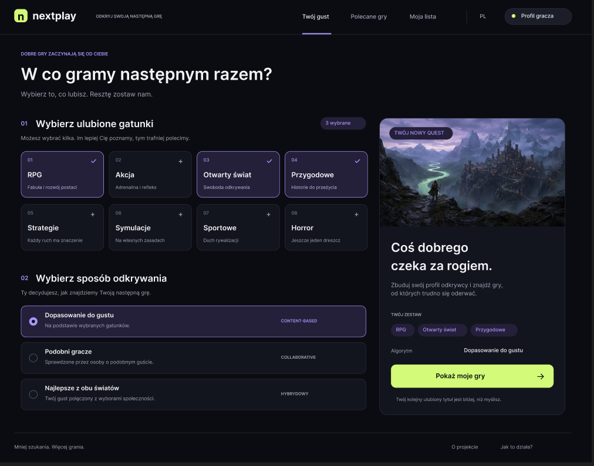

# System-rekomendacyjny

1. Cel projektu
Celem projektu jest praktyczne zaprojektowanie i implementacja kompletnego, systemu
rekomendacyjnego przy zastosowaniu danych pozyskanych z zewnętrznego źródła.
Należy zrealizować wskazany proces tworzenia rekomendacji:
zewnętrzne źródło danych → pobranie danych → przygotowanie danych → algorytm
rekomendacji → wygenerowanie rekomendacji → ocena trafności

Projekt ma na celu sprawdzenie umiejętności praktycznego wykorzystania algorytmów
rekomendacyjnych oraz integracji ich z aplikacją korzystającą z zewnętrznego źródła danych.
Zadania projektowe realizowane są w grupach 2-osobowych.

3. Założenia projektu
Należy wykonać aplikację realizującą mechanizm rekomendacyjny dla wybranej dziedziny, np.:
 filmów, książek, muzyki, produktów, gier, restauracji, miejsc turystycznych, artykułów, ofert
lub innych obiektów posiadających zestaw cech umożliwiających ich porównanie.
Źródłem danych powinno być zewnętrzne API.
Aplikacja musi realizować poniższe funkcje wykonane w trakcie spotkań projektowych.

4. Concept Art

